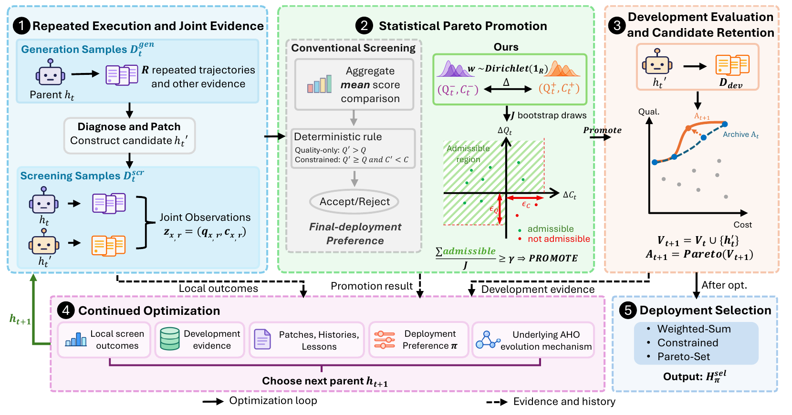

# ParetoSaddler: Pareto-Guided Optimization of Agent Harnesses for Quality and Cost

**ParetoSaddler** jointly improves agent response quality and LLM execution cost without
modifying model weights. It separates intermediate candidate promotion from final deployment
selection: repeated parent–candidate executions provide joint quality–cost evidence, Bayesian
bootstrap screening promotes credible progress in either objective, and broader development
evaluation maintains a Pareto archive for continued optimization and final selection. This branch integrates ParetoSaddler into [AutoSaddler](https://github.com/microsoft/AutoSaddler)
V2 with the Meta-ARE default agent on GAIA2.

📄 **[Paper](https://arxiv.org/abs/2611.02079)** · 🌐 **[Project website](https://autosaddler-projectpage.github.io/ParetoSaddler/)**

<p align="center">
  
</p>

| Component | Role |
|---|---|
| Repeated execution and joint evidence | Evaluates parent and candidate on matched tasks and records quality, task-agent USD cost, and execution traces |
| Statistical Pareto promotion | Uses Bayesian bootstrap support for progress in quality or cost, with a local quality-loss safeguard |
| Development evaluation and retention | Evaluates promoted candidates on the development split and maintains the nondominated archive |
| Continued optimization | Uses the current archive member, historical patches, and reflection lessons to construct subsequent candidates |
| Deployment selection | Returns the archive or selects its quality- or cost-extreme member after optimization |

## Results

Held-out results (as mean ± sample
standard deviation over three test executions). Quality is normalized rubric score (%) on
ClawMark and Pass@1 (%) on GAIA2; cost is task-agent LLM token cost in USD per task.
Task-agent models: `GPT-5.4 (high reasoning effort)` for ClawMark and
`GPT-5.5 (medium reasoning effort)` for GAIA2.

| Method | ClawMark quality ↑ | ClawMark cost ↓ | GAIA2 quality ↑ | GAIA2 cost ↓ |
|---|---:|---:|---:|---:|
| Default Agent | 70.86 ± 2.29 | $1.17 ± 0.17 | 56.22 ± 1.07 | $0.78 ± 0.08 |
| AutoSaddler (quality-only) | 73.86 ± 3.54 | $1.24 ± 0.04 | 57.33 ± 0.67 | $0.61 ± 0.03 |
| Meta-Harness (Pareto, cost endpoint) | 70.50 ± 3.92 | $0.97 ± 0.05 | 55.44 ± 1.50 | $0.80 ± 0.01 |
| Meta-Harness (Pareto, quality endpoint) | 73.25 ± 5.88 | $1.06 ± 0.06 | 54.33 ± 2.03 | $0.83 ± 0.07 |
| ParetoSaddler (Pareto, cost endpoint) | 79.60 ± 2.43 | $0.92 ± 0.08 | 62.11 ± 2.46 | $0.47 ± 0.00 |
| **ParetoSaddler (Pareto, quality endpoint)** | **81.35 ± 3.11** | **$1.01 ± 0.02** | **62.89 ± 2.14** | **$0.45 ± 0.02** |

The quality endpoint improves over the default agent by **10.49 percentage points on ClawMark**
and **6.67 points on GAIA2**, while reducing mean execution cost by approximately **13.7%**
and **42.3%**, respectively. Pareto endpoints are selected on development data before test evaluation.
This branch includes the GAIA2 integration; a ClawMark adapter is not included.

## Setup

Install with [uv](https://docs.astral.sh/uv/), Python 3.12–3.14, and Git:

```bash
git clone -b feat/paretosaddler https://github.com/Felixqxz/AutoSaddler.git AutoSaddler
cd AutoSaddler
uv sync --extra dev --extra meta-are-setup
```

Clone the adapted Meta-ARE repository next to AutoSaddler and check out the example configs'
pinned baseline. Keep generated workspaces in a separate working directory:

```bash
cd ..
git clone https://github.com/pshlego/Meta-ARE.git Meta-ARE
git -C Meta-ARE checkout --detach 395d1dd512add1e3aeb5a6a092490768b51e3ce5
mkdir -p working_dir
cd AutoSaddler

# Smoke split: 6 train, 1 development
uv run --extra meta-are-setup python scripts/meta_are/provision_gaia2_scenarios.py \
  --destination-root "$PWD/../Meta-ARE/datasets_local/gaia2_smoke" \
  --revision 78ea3bdbdeec2bdcd6afa5420915d8a22f23ed99

# Full split: 75 train, 65 development
uv run --extra meta-are-setup python scripts/meta_are/provision_gaia2_scenarios.py \
  --destination-root "$PWD/../Meta-ARE/datasets_local/gaia2" \
  --revision 78ea3bdbdeec2bdcd6afa5420915d8a22f23ed99 \
  --manifest configs/datasets/GAIA2/train.json \
  --manifest configs/datasets/GAIA2/val.json

# Demo filesystem shared by both splits
uv run --extra meta-are-setup python scripts/meta_are/provision_demo_filesystem.py \
  --destination-root "$PWD/../meta_are_data/gaia2_filesystem" \
  --revision 132e26376f5e963bb59f64bcccdd02188cb08dee \
  --meta-are-project ../Meta-ARE
```

Provisioning records source revisions and content digests. Training and development payloads
are provisioned for optimization; held-out test payloads are not evaluated by these commands.

## Run

| Objective | Full profile | Smoke profile |
|---|---|---|
| ParetoSaddler: quality and cost | [meta_are_pareto_full.yaml](configs/v2/meta_are_pareto_full.yaml) | [meta_are_pareto_smoke.yaml](configs/v2/meta_are_pareto_smoke.yaml) |
| AutoSaddler: quality only | [meta_are_full.yaml](configs/v2/meta_are_full.yaml) | [meta_are_smoke.yaml](configs/v2/meta_are_smoke.yaml) |

The full Pareto profile uses OpenAI `gpt-5.5` and a Copilot SDK optimizer with a custom OpenAI
Responses provider. Run from `working_dir`:

```bash
export OPENAI_API_KEY="..."
cd ../working_dir
RUN_ID="paretosaddler-full-$(date -u +%Y%m%dT%H%M%SZ)"
uv run --project ../AutoSaddler python -m autosaddler.v2.cli \
  --config ../AutoSaddler/configs/v2/meta_are_pareto_full.yaml \
  --run-id "$RUN_ID"
```

Full-run outputs are saved under `working_dir/outputs/v2_meta_are_pareto_full/runs/<run-id>/`;
`result.json` contains the final archive and candidate IDs. Resume with the same command,
run ID, and unchanged inputs. Retry allowances are not reset.

## Configuration

Key Pareto settings:

```yaml
scenario:
  settings:
    repetitions: 3
    task_agent_pricing:
      input_usd_per_million: 5.0
      cached_input_usd_per_million: 0.5
      output_usd_per_million: 30.0

optimization:
  final_selection: pareto
  acceptance:
    type: pareto
    parameters:
      draws: 10000
      rng_seed: 42
      max_accuracy_drop: 0.10
      joint_support_threshold: 0.70
  development:
    type: full_on_accept
  ranking:
    type: pareto
```

Set pricing for the evaluated model and endpoint.

| `optimization.final_selection` | Final output |
|---|---|
| `pareto` | Full archive |
| `score` (default) | Highest-scoring final archive member |
| `cost` | Lowest-cost final archive member |

See the [Pareto implementation overview](docs/v2-architecture.md#pareto-optimization),
[integration guide](docs/scenario-integration.md),
[Pareto prompts](src/autosaddler/v2/prompting/methodology/pareto/), and
[AutoSaddler README](https://github.com/microsoft/AutoSaddler/blob/main/README.md) for details.

## Citation

```bibtex
@misc{qian2026paretosaddler,
  title={ParetoSaddler: Pareto-Guided Optimization of Agent Harnesses for Quality and Cost},
  author={Xingzhi Qian and Sungho Park and Rongyuan Tan and Jianbo Yu and Jue Zhang and Lorenzo Cavallaro and Menglin Xia and Yanzhi Chen and Xinnuo Xu and Yu Kang and Xinran Zheng and Gagan Somashekar and Xuchao Zhang and Chetan Bansal and Qingwei Lin and Victor Rühle},
  year={2026},
  eprint={2611.02079},
  archivePrefix={arXiv},
  primaryClass={cs.AI},
  url={https://arxiv.org/abs/2611.02079}
}
```

This project is available under the [MIT License](LICENSE).
